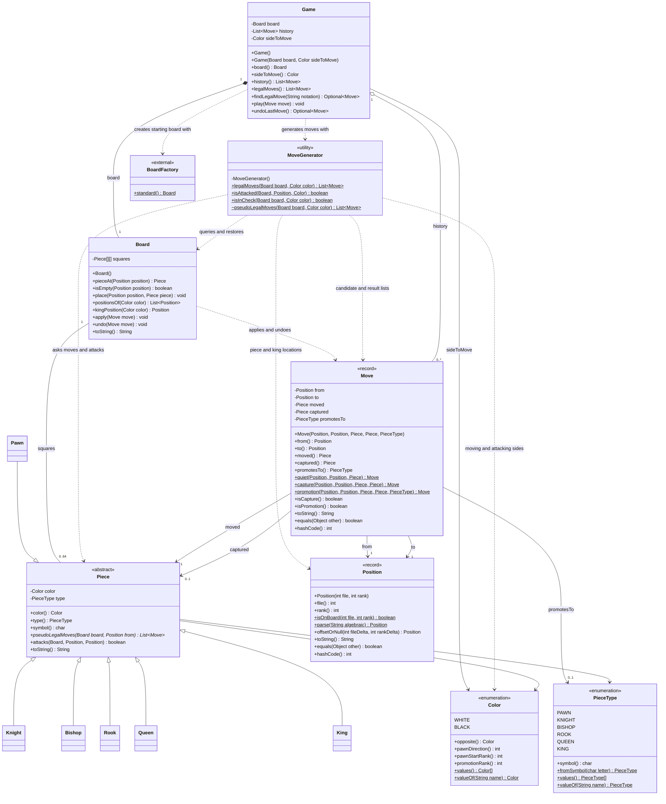
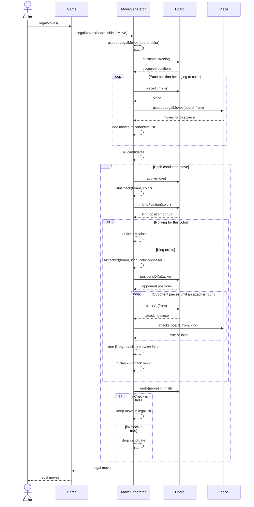

# M5 Chess Engine Design

## Class Diagram

This diagram shows the classes in the `engine` and `model` packages.
`BoardFactory` is included because `Game` uses it to create the starting
board. The six piece subclasses are shown without their methods to keep
the diagram readable.

`Game` stores the board, move history, and whose turn it is.
`MoveGenerator` has no fields. It uses the board passed to its static
methods to find legal moves.

`Move` records where a piece moved from and to, what was captured, and
whether it promoted. This gives `Board.undo` the information it needs
to restore the position.

Only the `BoardFactory` method used by `Game` is shown.

## Sequence Diagram

This diagram shows what happens when `game.legalMoves()` is called.
The `Piece` lifeline represents whichever piece is being checked.
The smaller board queries inside piece methods are left out.

Each candidate move is played, checked, and undone. It is kept only if
the moving side's king is not in check. The `finally` block restores the
board even if checking for attacks throws an exception.

Pawns use their own attack method because they attack diagonally.
A side without a king is treated as not in check, which allows partial
boards to work in the tests.